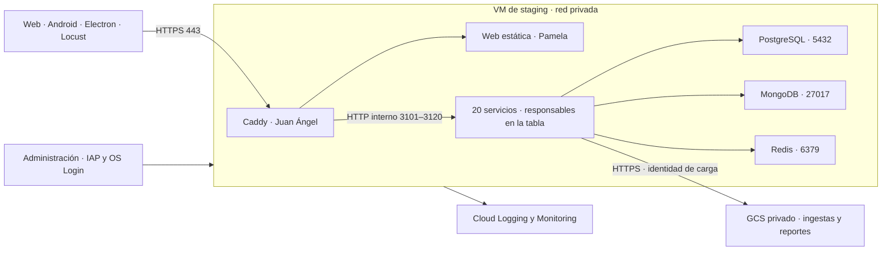

# Preparación de staging en GCP

Los resultados y la evidencia de seguridad se registran en
[Pruebas de fallos](pruebas-de-fallos.md).

## Rutas por ambiente

El origen público previsto para la IP reservada es `https://34.51.89.203`.
Para emitir el certificado y activar la redirección usa la
[guía de HTTPS por IP](https-por-ip.md). Al desplegar, comunica a
web, Android, Electron y Locust los prefijos de la tabla. Usa el prefijo
sin `/v1` como base y añade `/v1/<recurso>` al construir la petición.
El web ya lo añade al crear el cliente. Android y Electron necesitan
bases por servicio en staging, con la barra final si su cliente la exige.
El build web con `npm run build -- --mode staging` usa el mismo origen
por defecto. Un valor explícito como
`VITE_AUTH_URL=https://34.51.89.203/api/auth-service` tiene prioridad.

Los archivos [Caddyfile.ip](Caddyfile.ip) para IP pública y
[Caddyfile](Caddyfile) para un dominio comparten [las rutas](routes.caddy).
Sirven el build estático desde `/srv/web`. En HTTPS, Caddy termina TLS
en 443, redirige HTTP y quita `/api/<servicio>` antes de
reenviar al puerto interno. Los health internos, Swagger, consolas de
datos, las rutas internas de transacciones y los POST de eventos se
consultan dentro de la red. Si se usa un proxy de salida, incluye los
nombres internos de los servicios en `NO_PROXY`.
Las rutas de la tabla se habilitan a medida que se despliega su servicio.

| Servicio | Puerto interno | Prefijo externo tras desplegar | Responsable | Presente en Compose de base |
|---|---:|---|---|---|
| auth-service | 3101 | `/api/auth-service` | Juan Ángel | Sí |
| catalog-service | 3102 | `/api/catalog-service` | Pamela | Sí |
| pricing-service | 3103 | `/api/pricing-service` | Pamela | Sí |
| core-process-service | 3104 | `/api/core-process-service` | Juan Ángel | Sí |
| algorithms-core | 3105 | `/api/algorithms-core` | Leonardo | Sí |
| analytics-stats | 3106 | `/api/analytics-stats` | Leonardo | Sí |
| decision-service | 3107 | `/api/decision-service` | Fernando | Sí |
| documents-service | 3108 | `/api/documents-service` | Pamela | Sí |
| notifications-service | 3109 | `/api/notifications-service` | Juan Ángel | Sí |
| audit-service | 3110 | `/api/audit-service` | Juan Ángel | Sí |
| transactions-ingestion-service | 3111 | `/api/transactions-ingestion-service` | Juan Ángel | Sí |
| income-segmentation-service | 3112 | `/api/income-segmentation-service` | Pamela | Sí |
| basket-analysis-service | 3113 | `/api/basket-analysis-service` | Leonardo | Sí |
| availability-service | 3114 | `/api/availability-service` | Pamela | Sí |
| promotion-service | 3115 | `/api/promotion-service` | Fernando | Pendiente |
| demand-forecast-service | 3116 | `/api/demand-forecast-service` | Leonardo | Sí |
| recommendations-workflow-service | 3117 | `/api/recommendations-workflow-service` | Fernando | Pendiente |
| offline-sync-service | 3118 | `/api/offline-sync-service` | Fernando | Sí |
| data-governance-service | 3119 | `/api/data-governance-service` | Leonardo | Sí |
| monitoring-service | 3120 | `/api/monitoring-service` | Juan Ángel | Sí |

## Inventario, costo y despliegue

1. Con una cuenta de solo lectura, recopila proyecto, zona, tipo de VM,
   vCPU, RAM, discos, IP, cuenta adjunta, red y reglas vigentes. Usa
   `gcloud compute instances list --project "$GCP_PROJECT"`,
   `gcloud compute instances describe "$STAGING_VM" --project "$GCP_PROJECT" --zone "$GCP_ZONE"`,
   `gcloud compute disks list --project "$GCP_PROJECT"`,
   `gcloud compute addresses list --project "$GCP_PROJECT"` y
   `gcloud compute firewall-rules list --project "$GCP_PROJECT"`.
   Confirma si la VM ya sirve la demo anterior y registra fecha del inventario.
2. Presupuesta VM por horas, discos, IP, Artifact Registry, GCS,
   snapshots, tráfico, logs y métricas. Registra región, supuestos y
   total previsto para autorización antes de provisionar. Mide CPU,
   memoria y disco con los 20 procesos y ajusta capacidad. Para demo,
   los tres motores pueden usar volúmenes separados en discos
   persistentes de una VM. Esa VM es un punto único de fallo.
3. Separa dev, staging y producción con redes, identidades, datos,
   discos y secretos por ambiente. En staging usa datos sintéticos.
   Publica únicamente 80/443 y configura administración por IAP y OS
   Login. Caddy requiere almacenamiento persistente. Para HTTPS por
   dominio, configura el DNS. Si usas la IP reservada, sigue la
   [guía de HTTPS por IP](https-por-ip.md). Verifica el certificado desde
   una red externa. El Compose local expone puertos y usa credenciales
   de desarrollo, así que staging requiere un manifiesto dedicado.
4. Compila los Dockerfiles y el build de Vite con el mismo SHA.
   Publica en Artifact Registry y registra SHA, digest, versión, puerto,
   variables, dependencias, migración y prueba para cada servicio.
   Despliega por digest y guarda el manifiesto anterior. Usa un
   servicio systemd o equivalente para arrancar el stack tras reinicio.
5. Inyecta únicamente referencias a Secret Manager y credenciales
   en tiempo de ejecución. Inventaría JWT, Postgres, MongoDB, Redis y
   correo. Comprueba que NestJS y FastAPI admiten credenciales Redis
   antes de activar ACL y valida 503 de una ruta protegida cuando no
   puede consultar sesión. Configura zona horaria y CORS por entorno.
6. Crea almacenamiento con acceso uniforme, prevención de acceso
   público, claves por ambiente y permisos mínimos para la identidad
   de carga. Acordar `GCS_INGESTION_BUCKET` y
   `GCS_INGESTION_INCOMING_PREFIX` con los consumidores. Prueba
   escritura, lectura autorizada y expiración de URL V4 firmada por
   IAM. Acordar retención con gobierno de datos.
7. Envía logs con servicio, versión y correlación. Configura métricas
   de CPU, RAM, disco y red en Cloud Monitoring. Tras el despliegue,
   realiza una operación real por HTTPS con credenciales sintéticas,
   prueba los tres clientes y conserva resultados sin tokens.

## Respaldo, rollback y evidencia

Antes de migrar, guarda un `pg_dump -Fc`, un `mongodump --archive` y un
respaldo de Redis conforme al modo de persistencia configurado. Cifra
los respaldos y registra SHA, fecha y retención. Restaura cada respaldo
en un destino aislado y compara conteos de negocio y consultas de
control. Valida que una sesión de prueba responda como se espera tras
reiniciar. Conserva el resultado de una operación posterior.

Si el release falla, detén escrituras, verifica compatibilidad con
el esquema aplicado y activa el manifiesto anterior por digest.
Si hay cambios incompatibles, prueba la restauración en una base separada
y acuerda la ventana de pérdida de datos antes de conmutar. Vuelve a probar
HTTPS, autenticación, una operación de negocio y su correlación. Para
promoción, reutiliza el digest probado con configuración del nuevo ambiente.

Completa T-24 con el mismo SHA y fecha. Para servicio detenido, Redis,
MongoDB, PostgreSQL, bucket y respuesta lenta, registra síntoma del
cliente, estado, tiempo de detección, recuperación, persistencia y
resultado de una operación posterior. Añade las trazas de campo,
ingesta/análisis y reporte privado, y el recorrido canasta típica,
pronóstico, promoción y seguimiento.

Pendientes de ejecución en GCP. URL HTTPS, inventario, costo autorizado,
digest desplegado, prueba externa, reinicio, restauración, firma V4 y
matriz de fallos.

Consulta la [actualización y observabilidad](actualizacion.md) y la
[evidencia de recuperación](evidencia-recuperacion.md) para la revisión de
esta versión.
